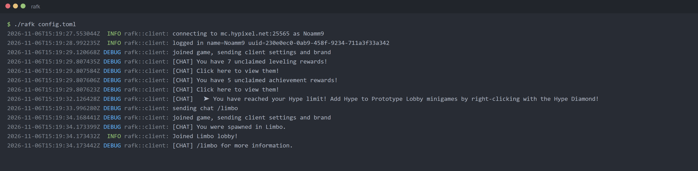
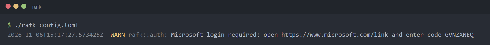

# rafk

A headless Minecraft client written in Rust that keeps your account AFK in Hypixel Limbo. 

I made it because I needed my account to be connected to hypixel at least once every 60 days to not lose my Hypixel api key. 



## Design

rafk acts as a 1.8.9 Minecraft client because the 1.8 protocol is by far the simplest protocol to implement.
its very lightweight as it does not have a configuration phase or registries and chat signing.
  
## First run

create a config.toml file or copy the example at [config.toml](config.toml)

The config path defaults to `./config.toml` if you leave it out.

```sh 
./rafk 
```

The first time, rafk asks you to sign in:


Open the link on any device, enter the code and sign in with the Microsoft account that owns Minecraft. 

The tokens are saved to `auth.cache_path` (`token.json` by default). 
Keep that file private, 

when it's running, anything you type into the terminal is sent as chat. Start the line with `/` for a command, like `/locraw`.

## License

[BSD 3-Clause](LICENSE).